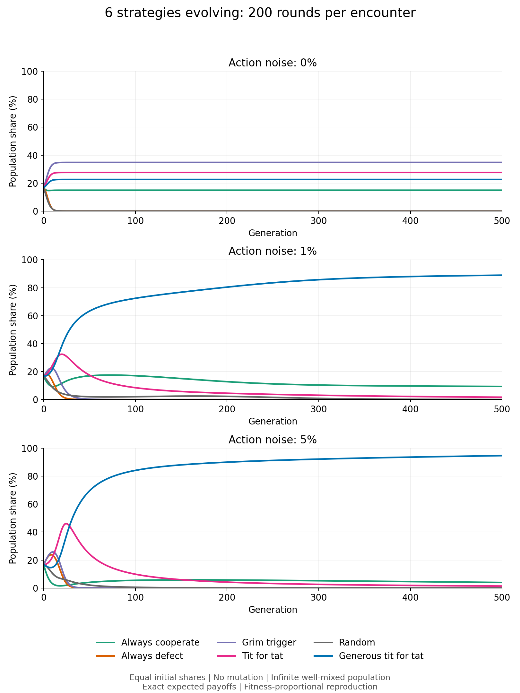
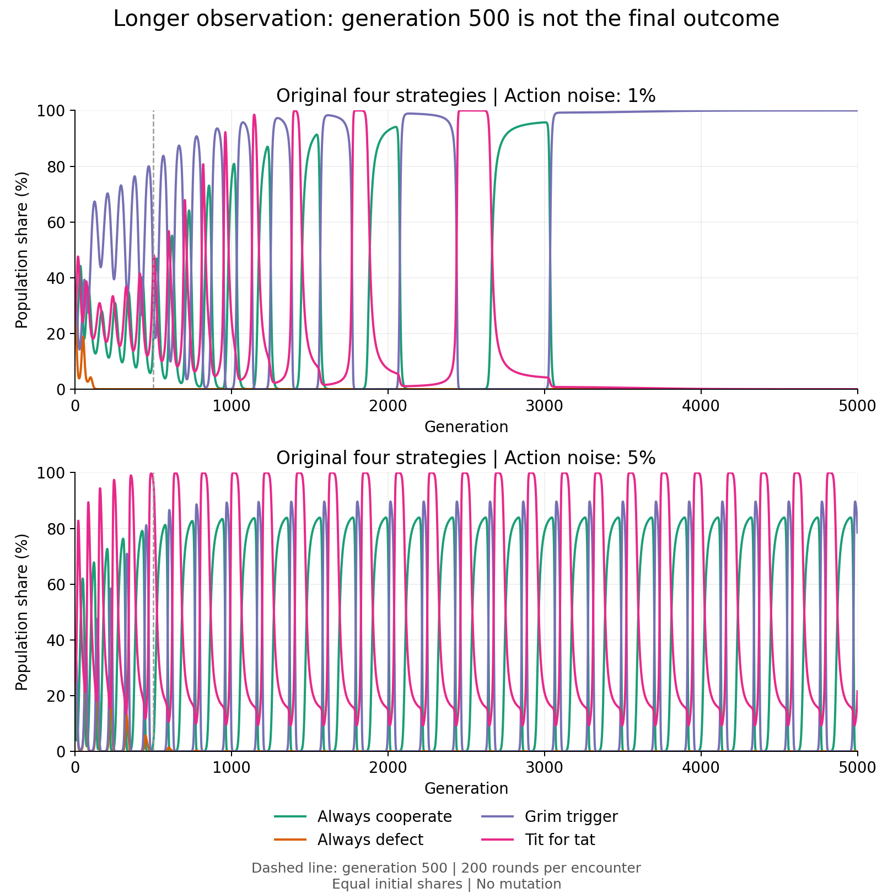

# Iterated Prisoner's Dilemma: Strategy Evolution

English | [简体中文](README.zh-CN.md)

A reproducible Python experiment comparing repeated-game strategies and their population dynamics. It computes **exact expected match payoffs**, then applies deterministic, fitness-proportional reproduction in an infinite, well-mixed population.

The central question: **does winning a fixed round-robin tournament also mean winning as the population changes?**

## Main result

With six initially equally common strategies, 200 rounds per encounter, and no mutation, **Generous Tit for Tat reaches 88.91% of the population at 1% action noise and 94.64% at 5% noise after 500 generations**. Without noise, several cooperative strategies coexist.

These are results for the specified strategies and initial conditions, not a claim that one strategy is universally optimal. In the original four-strategy population, extending the run beyond 500 generations reveals large reversals and oscillations.



## Quick start

Python 3.11+ is recommended with the pinned dependencies below. The source uses Python 3.10+ syntax; the supported Python versions of pinned packages may be narrower.

```bash
python -m venv .venv
# Linux/macOS:
source .venv/bin/activate
# Windows PowerShell: .venv\Scripts\Activate.ps1
python -m pip install -r requirements.txt
python experiment.py --output results
```

The program runs its regression checks, regenerates the result JSON and three figures, and prints the main results. It does not access the network during the experiment. There is no random seed: stochastic choices are integrated into expected payoffs rather than sampled.

To run only the regression checks:

```bash
python -c "from experiment import tests; print(tests())"
```

Committed figures use English labels and Matplotlib's default fonts. Figure rendering can vary across platforms; scientific comparisons should use the numeric JSON.

## Game and strategies

Each player simultaneously chooses cooperation (C) or defection (D).

| Player A | Player B | A payoff | B payoff |
|---|---|---:|---:|
| C | C | 3 | 3 |
| C | D | 0 | 5 |
| D | C | 5 | 0 |
| D | D | 1 | 1 |

| Strategy | Rule |
|---|---|
| Always cooperate | Cooperate every round. |
| Always defect | Defect every round. |
| Grim trigger | Cooperate initially; after any observed opponent defection, defect forever. |
| Tit for tat | Cooperate initially; then copy the opponent's previous actual action. |
| Random | Independently cooperate or defect with equal probability each round. |
| Generous tit for tat | Cooperate initially and after opponent cooperation; after opponent defection, cooperate with probability 1/3 and defect with probability 2/3. |

Action noise is applied **after** the intended action: each player's action independently flips with the specified probability. Players observe executed actions, not intentions. Every new encounter resets memory. Self-play means two independent copies of the same strategy; the payoff matrix includes each player's expected score once, not both scores added together.

## Experiment design

- Strategy sets: the original four strategies, and all six strategies.
- Encounter lengths: 20, 200, and 1000 rounds.
- Action noise: 0%, 1%, and 5%.
- Initial population: equal shares within each strategy set.
- Duration: 5000 generations, with detailed saved trajectories for generations 0–500 and later endpoint diagnostics.
- Default mutation: zero.
- Sensitivity check: for 200-round encounters, repeat with 0.1% uniform mutation after reproduction.

This produces 18 main scenarios, plus six mutation sensitivity runs. Comparing raw round-robin totals across the four- and six-strategy sets is inappropriate because they contain different numbers of opponents.

## Method

### Exact expected payoffs

A 16-state Markov calculation tracks both players' previous actions and whether each player has ever defected. The first round is treated separately. Propagating the state distribution accounts for every possible combination of random decisions, forgiveness, and action errors.

“Exact” here means no Monte Carlo sampling error, subject to floating-point arithmetic. It does not remove uncertainty about which model assumptions are appropriate.

### Population dynamics

Let `A[i,j]` be strategy `i`'s expected payoff against strategy `j`, and `p[i]` its population share. Each generation uses:

```text
fitness[i] = sum_j A[i,j] * p[j]
p_next[i] = p[i] * fitness[i] / sum_k p[k] * fitness[k]
```

With mutation rate `mu`, the newborn proportions become:

```text
p_next[i] = (1 - mu) * p_next[i] + mu / number_of_strategies
```

The implementation updates log frequencies to avoid prematurely discarding rare strategies. Very small values can display as zero when converted to ordinary floating-point proportions. No explicit extinction threshold is applied.

This is a deterministic **infinite-population proportion model**, not a finite-agent simulation. It has no demographic drift, integer births, spatial neighborhoods, migration, or individual learning. Because all encounters in a scenario have the same length, using mean payoff per round instead of total match payoff gives the same reproduction proportions.

## Selected results

### Six strategies, 200 rounds, generation 500, no mutation

| Action noise | Always cooperate | Always defect | Grim trigger | Tit for tat | Random | Generous tit for tat |
|---|---:|---:|---:|---:|---:|---:|
| 0% | 14.93% | Near zero | 34.81% | 27.63% | Near zero | 22.63% |
| 1% | 9.37% | Near zero | Near zero | 1.68% | 0.038% | 88.91% |
| 5% | 3.96% | Near zero | Near zero | 1.40% | 0.0009% | 94.64% |

At generation 5000, Generous Tit for Tat reaches 96.91% under 1% noise and 99.989% under 5% noise. With 0.1% uniform mutation, its corresponding shares are 86.49% and 89.98%.

Without noise, the surviving cooperation-oriented strategies obtain the same payoffs against one another, allowing coexistence. Under noise, forgiveness can interrupt retaliation and restore cooperation, although it also makes exploitation possible.

### A snapshot is not an equilibrium

In the original four-strategy experiment with 5% noise, Tit for Tat holds 96.83% at generation 500. At generation 5000, Grim Trigger holds 78.45% and Tit for Tat 21.55%, within an oscillating trajectory. Neither snapshot establishes a final winner.



Rebounds from extremely small shares depend on the infinite-population assumption. In a finite population, a strategy with zero individuals cannot return without mutation or immigration. Initial population composition can also matter; this experiment does not sweep all initial conditions.

## Validation

The program checks:

- The full original four-strategy payoff matrix without noise.
- The 200-round round-robin totals: **1800, 1608, 1999, 1999**, respectively.
- Persistent Grim Trigger memory and Tit for Tat's previous-action memory.
- Generous Tit for Tat's forgiveness probability.
- Random self-play payoff and a 100% action-flip edge case.
- Transition probability conservation, payoff bounds, and population normalization.
- Neutral evolution when fitnesses are equal.
- At 50% action noise, all six-strategy matrix entries equal 450 for 200 rounds and equal population shares remain unchanged.

These checks validate the implementation against known cases. They are not a proof that the chosen model captures real-world cooperation.

## Files

- `experiment.py`: payoff calculation, population update, regression checks, and figure generation.
- `requirements.txt`: tested package versions.
- `results/results.json`: parameters, payoff matrices, tournament totals, generation 0–500 trajectories, later endpoints, mutation sensitivity, and test status.
- `results/evolution_4_strategies.png`: original four-strategy trajectories.
- `results/evolution_6_strategies.png`: expanded six-strategy trajectories.
- `results/evolution_long_diagnostic.png`: 5000-generation diagnostic.
- `README.zh-CN.md`: Chinese explanation.

## Possible next experiments

These are suggestions, not results already produced:

1. **Finite populations:** compare population sizes such as 100, 1000, and 10000 over repeated seeds. Measure extinction probability and the difference from deterministic proportions.
2. **Forgiveness sweep:** vary the forgiveness probability from 0 to 1 rather than assuming 1/3 is best.
3. **Initial-condition sensitivity:** test rare-strategy invasion and different starting population mixtures.
4. **Additional strategy families:** add Win-Stay, Lose-Shift and more memory-based strategies.
5. **Different error mechanisms:** distinguish action errors from observation errors, and vary mutation separately from either.

## License

MIT. See [LICENSE](LICENSE).
